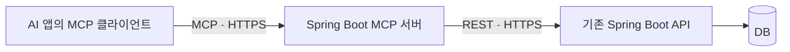

# Spring Boot API를 호출하는 MCP 서버 구성 가이드

작성일: 2026-11-14

## 1. 결론

**Spring Boot 기반 MCP 서버를 만들 수 있다. 기존 Spring Boot API 앞에 별도의 Spring Boot MCP 서버를 두는 구성을 권장한다.**

Spring AI는 MCP 서버용 Starter와 Tool 등록 기능을 제공한다. Java와 Spring Boot에 익숙한 팀이라면 다른 언어로 전환할 필요가 없다. MCP 서버는 AI 애플리케이션이 호출할 기능을 노출하고, 실제 업무 처리는 기존 API에 위임한다. 이 역할만 수행하는 MCP 서버에는 별도의 LLM이나 모델 API 키가 필요하지 않다.

기본 Tool 연결보다 설계에 더 주의해야 하는 부분은 인증과 사용자별 데이터 접근 권한이다. 특히 MCP 서버의 서비스 권한과 실제 사용자의 권한을 구분해야 한다.

근거: [Spring AI MCP Server Boot Starter](https://docs.spring.io/spring-ai/reference/api/mcp/mcp-server-boot-starter-docs.html)

## 2. 권장 아키텍처



Mermaid를 지원하지 않는 뷰어에서는 다음 흐름으로 이해하면 된다.

```text
AI 앱의 MCP 클라이언트 → Spring Boot MCP 서버 → 기존 Spring Boot API → DB
```

| 구성 요소 | 책임 |
|---|---|
| MCP 클라이언트 | 사용자의 요청에 맞는 Tool을 선택하고 MCP 요청 전송 |
| MCP 서버 | 호출자 인증, Tool 실행 권한 검사, 입력 검증, API 호출, 응답 가공 |
| 기존 API 서버 | 업무 규칙 실행, 사용자·테넌트·객체 접근 권한의 최종 검증 |
| 인증 서버 | MCP 또는 API를 대상으로 하는 액세스 토큰 발급 |

예를 들어 사용자가 “주문 123의 배송 상태를 알려줘”라고 요청하면 다음 순서로 처리한다.

1. MCP 클라이언트가 `get_order_status(orderId=123)`을 호출한다.
2. MCP 서버가 호출자의 인증 상태와 조회 권한을 확인한다.
3. MCP 서버가 API용 자격 증명으로 `GET /api/orders/123/status`를 호출한다.
4. 기존 API가 해당 주문에 대한 접근 권한을 검사하고 배송 상태를 반환한다.
5. MCP 서버가 AI에 필요한 필드만 반환한다.

기존 API 앱에 MCP 기능을 함께 넣는 것도 가능하다. 다만 별도 앱으로 분리하면 의존성, 배포, 장애 영향, 접근 권한을 독립적으로 관리하기 쉽다. HTTP로 연동하므로 기존 API의 Spring Boot 버전을 MCP 서버에 맞춰 변경할 필요도 없다.

## 3. Spring Boot 구현 구성

원격 접속을 제공하는 서버를 기준으로 다음 구성을 권장한다.

| 구성 요소 | 역할 |
|---|---|
| `spring-ai-starter-mcp-server-webmvc` | MCP 요청 처리와 서버 자동 구성 |
| `@McpTool` | Java 메서드를 MCP Tool로 등록 |
| `RestClient` | 기존 REST API 호출 |
| Spring Security Resource Server | MCP에 들어오는 요청의 인증 및 권한 검사 구성 |
| Spring Security OAuth2 Client | 기존 API용 토큰 발급·관리 및 HTTP 요청에 연결 |

Spring AI와 Spring Boot는 공식 문서에서 지원하는 버전 조합을 선택하고, Spring AI BOM으로 관련 의존성 버전을 관리한다. 기존 API의 버전과 새 MCP 서버의 버전은 독립적으로 결정할 수 있다.

참고: [Spring AI 시작하기](https://docs.spring.io/spring-ai/reference/getting-started.html), [MCP 서버 어노테이션](https://docs.spring.io/spring-ai/reference/api/mcp/mcp-annotations-server.html)

### 전송 방식

| 사용 환경 | 선택 |
|---|---|
| 여러 사용자가 네트워크로 접속하는 서버 | Streamable HTTP |
| 개발 도구가 로컬 MCP 프로세스를 직접 실행 | STDIO |

접속할 MCP 클라이언트가 선택한 전송 방식과 인증 방식을 지원하는지 확인해야 한다.

원격 서버의 프로토콜 설정 예시는 다음과 같다.

```yaml
spring:
  ai:
    mcp:
      server:
        name: internal-api-mcp
        type: SYNC
        protocol: STREAMABLE
```

**위 설정은 MCP 프로토콜 설정 예시이며, 실행 가능한 전체 프로젝트나 보안 설정이 아니다.** Starter의 HTTP 엔드포인트에는 인증과 인가가 자동으로 적용되지 않는다. 외부에서 접근하도록 배포하기 전에 별도 보안 구성을 완료해야 한다.

근거: [MCP Starter의 전송 방식 및 보안 기본값](https://docs.spring.io/spring-ai/reference/api/mcp/mcp-server-boot-starter-docs.html)

### 코드의 역할 분리

```text
OrderTools              MCP Tool 정의, 입력 검증, 실행 권한 검사
    ↓
OrderApiClient          고정된 API 경로 호출, 타임아웃, 오류 처리
    ↓
기존 Spring Boot API    업무 처리, 최종 데이터 접근 권한 검사
```

인증된 사용자 정보는 서버에서 검증한 요청 컨텍스트로 전달한다. AI가 지정하는 Tool 인수에 사용자 신원이나 인증 토큰을 맡기지 않는다.

## 4. 두 구간의 인증을 분리하기

```text
MCP 클라이언트 ── MCP 서버용 토큰 ──▶ MCP 서버
MCP 서버      ── 기존 API용 토큰 ──▶ Spring Boot API
```

### MCP 클라이언트 → MCP 서버

원격 다중 사용자 환경에서는 OAuth 기반 인증을 구성한다. JWT를 사용한다면 서명, 발급자, 만료, 대상 서비스인 `audience`를 검증한다. 인증 성공 후에도 각 Tool을 실행할 권한이 있는지 별도로 확인해야 한다.

MCP 클라이언트와 OAuth로 연동하려면 단순히 Bearer 토큰을 검사하는 것 외에도, 적용하는 MCP 인증 명세에 맞는 보호 자원 메타데이터와 인증 서버 발견 기능을 구성해야 한다.

근거: [MCP Authorization](https://modelcontextprotocol.io/specification/2025-11-25/basic/authorization)

### MCP 서버 → 기존 API

| 상황 | 권장 방식 | 주의점 |
|---|---|---|
| 서비스 권한으로 허용된 공통 업무 수행 | 전용 서비스 계정 + OAuth2 Client Credentials | 사용자별 권한은 전달되지 않음 |
| 사용자별로 조회·수정 가능한 데이터가 다름 | 사용자 위임을 통해 발급받은 API용 토큰 | 인증 서버가 지원하면 Token Exchange 또는 OBO 방식 검토 |
| 기존 API가 API Key만 지원 | MCP 전용 최소 권한 키 | 서버 비밀 저장소에서 관리하고 사용자별 접근 통제를 별도로 설계 |

**Client Credentials는 사용자 인증을 대신하지 않는다.** 모든 요청이 하나의 서비스 계정 권한으로 처리될 수 있다. 사용자별 주문이나 문서를 조회해야 한다면 기존 API가 검증할 수 있는 사용자 위임 체계를 설계해야 한다. Tool 인수나 검증되지 않은 `X-User-Id` 헤더만으로 사용자를 식별해서는 안 된다.

클라이언트가 보낸 Bearer 토큰을 기존 API로 그대로 전달하는 범용 프록시는 피한다. MCP 서버는 자신을 대상으로 발급된 토큰을 검증하고, 기존 API에는 해당 API를 대상으로 하는 별도의 자격 증명을 사용한다.

참고: [Spring Security OAuth2 Client 기능](https://docs.spring.io/spring-security/reference/servlet/oauth2/client/authorized-clients.html), [MCP Token Passthrough 보안 지침](https://modelcontextprotocol.io/specification/2025-11-25/basic/security_best_practices)

## 5. Tool과 API 호출을 안전하게 제한하기

### 업무 단위로 Tool 정의

권장하는 Tool 형태는 다음과 같다.

```text
get_order_status(orderId)
search_products(keyword, pageSize)
```

다음처럼 호출 대상과 인증 헤더를 자유롭게 지정하는 Tool은 제공하지 않는 것을 권장한다.

```text
call_api(url, method, headers, body)
```

범용 HTTP Tool은 임의의 내부 주소 호출, 의도하지 않은 API 접근, 자격 증명 유출 경로를 만들 수 있다. API의 기본 주소, 허용 경로, HTTP 메서드는 서버 코드나 신뢰할 수 있는 설정으로 고정한다. Tool의 입력값은 ID, 검색어, 페이지 크기 등 필요한 업무 인수로 제한한다.

### 운영 통제

| 통제 | 적용 방법 |
|---|---|
| 호출 대상과 네트워크 제한 | 허용된 API 목적지만 접근하도록 제한하고, 리다이렉트로 제한을 우회하지 못하게 구성 |
| 사용자·객체 권한 검사 | MCP에서 기능 권한을 검사하고 API에서 사용자·테넌트·객체 접근 권한을 최종 검증 |
| 비밀과 응답 최소화 | 토큰은 서버에서 주입하고, 응답·오류·로그에서 비밀과 불필요한 개인정보 제거 |
| 부하와 실패 제어 | 연결·응답 타임아웃, 호출량·페이지 크기 제한, 조회 요청의 제한적 재시도 적용 |
| 변경 작업 보호 | 사용자 확인과 서버의 승인 검증, 중복 실행 방지 키, 감사 기록 적용 |

`/mcp`에 접근할 수 있다는 이유만으로 모든 Tool 실행을 허용하지 않는다. Tool마다 필요한 권한을 검사하고, 실제 API가 데이터를 읽거나 수정하기 전에 해당 객체에 대한 권한을 다시 확인한다.

취소·삭제와 같은 작업은 승인된 작업 내용과 실제 실행할 내용을 서버에서 연결해 검증해야 한다. AI가 인수에 `approved=true`를 넣는 방식은 사용자 승인으로 취급하지 않는다. `readOnlyHint`, `destructiveHint` 같은 Tool 메타데이터 역시 실행 권한 검사나 승인 절차를 대체하지 않는다.

## 6. Spring Boot 이외의 대안

Java 실행 환경을 두기 어렵거나 팀이 다른 언어에 더 익숙하다면 공식 SDK로 같은 구조를 만들 수 있다.

| 선택 | 적합한 상황 |
|---|---|
| Spring Boot + Spring AI | 기존 Java 경험과 Spring Security 운영 경험을 활용할 때 |
| TypeScript MCP SDK | Node.js 운영 환경과 TypeScript 경험이 있을 때 |
| Python MCP SDK | Python 기반 도구와 함께 개발·운영할 때 |

어떤 언어를 사용해도 기존 Spring Boot API와 HTTP로 통신할 수 있다. 언어를 바꿔도 인증, 사용자 위임, 권한 검사, 비밀 관리의 설계는 필요하다.

공식 SDK: [TypeScript](https://ts.sdk.modelcontextprotocol.io/), [Python](https://github.com/modelcontextprotocol/python-sdk)

## 7. 구현 순서와 완료 기준

1. **연동 조건 확인:** 기존 API의 Spring Boot 버전, 인증 방식, 접속할 MCP 클라이언트, 사용자별 권한 필요 여부를 정리한다.
2. **조회 Tool 하나 구현:** 별도 MCP 앱에서 고정된 조회 API를 호출하고 필요한 필드만 반환한다.
3. **인증과 권한 연결:** MCP 접속 인증과 API 호출 자격 증명을 분리하고, 사용자별 데이터 접근 정책을 적용한다.
4. **실패와 오용 검증:** 무인증 요청, 잘못된 audience, 다른 사용자의 객체 조회, 비정상 입력, API 타임아웃을 검증한다.
5. **필요한 기능 확대:** 조회 기능의 접근 통제를 확인한 뒤 승인·중복 실행 방지 설계를 갖춘 변경 Tool을 추가한다.

첫 조회 Tool의 완료 기준은 정상 호출 성공뿐 아니라, 무권한 호출이 차단되고 응답과 로그에 비밀이 노출되지 않는 것이다.

다음 행동: 2분 동안 기존 API의 Spring Boot 버전, 인증 방식, 먼저 연결할 조회 엔드포인트 1개를 정리한다.
